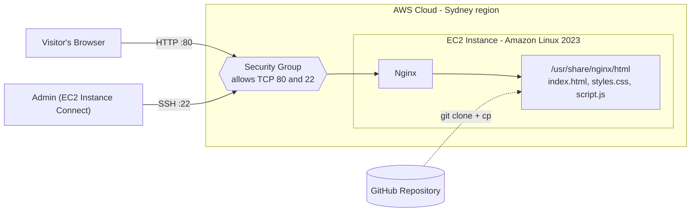

# Static Portfolio Website on AWS EC2

A static portfolio website (HTML, CSS, JavaScript) served by **Nginx** on an **Amazon Linux 2023** EC2 instance, with source code managed in GitHub.

## Architecture



**Request flow:** the visitor reaches the instance's public IPv4 address, the security group allows traffic on port 80, and Nginx serves the static files from its document root. Files get there by cloning the GitHub repo onto the instance and copying them into that directory.

## Tech Stack

| Tool | Purpose |
|------|---------|
| AWS EC2 (Amazon Linux 2023, Sydney region) | Hosts the server |
| Nginx | Serves the static files |
| AWS Security Groups | Virtual firewall for inbound traffic |
| Git / GitHub | Version control and code transfer |
| HTML, CSS, JavaScript | Website structure, styling, interactivity |

## Repository Contents

| File | Description |
|------|-------------|
| `index.html` | Main page and content |
| `styles.css` | Layout and styling |
| `script.js` | Client-side interactivity |
| `README.md` | Documentation |

## Deployment Steps

**1. Launch the instance.** Create an Amazon Linux 2023 EC2 instance in the Asia Pacific (Sydney) region.

**2. Configure the security group.**
- Allow inbound **HTTP (TCP 80)** from `0.0.0.0/0` for public access.
- Allow inbound **SSH (TCP 22)** only from the EC2 Instance Connect IP range for your region.

**3. Connect.** Use EC2 Instance Connect from the AWS Console (browser-based terminal).

**4. Install and start Nginx and Git.**
```bash
sudo dnf install -y git nginx
sudo systemctl enable --now nginx
sudo systemctl status nginx
```

**5. Clone the repository.**
```bash
git clone https://github.com/USERNAME/REPOSITORY.git
cd REPOSITORY
```

**6. Publish the files.**
```bash
sudo cp index.html styles.css script.js /usr/share/nginx/html/
sudo systemctl restart nginx
```

**7. Visit the site.** Open `http://YOUR-EC2-PUBLIC-IP` in a browser.

## Verification

```bash
sudo systemctl status nginx          # Nginx is running
curl -I http://localhost             # Expect HTTP 200
ls -l /usr/share/nginx/html/         # Files are in place
```

Then load the public IP from outside the server to confirm external access.

## Troubleshooting Notes

| Problem | Cause | Fix |
|---------|-------|-----|
| EC2 Instance Connect: "SSH not authorized" | Security group had no port 22 rule | Add an inbound TCP 22 rule for the EC2 Instance Connect IP range |
| `systemctl` command failed | Typo, or several commands pasted on one line | Run commands one at a time and check with `systemctl status nginx` |
| Site shows the Nginx default page | Installing Nginx does not publish repo files | Copy site files into `/usr/share/nginx/html/` |
| Site unreachable from the internet | Running instance does not mean open access | Allow port 80 in the security group and use the instance's public IPv4 |
| User data Base64 error at launch | Startup script not in the format the launch method expects | Follow the encoding rules for the console, CLI, or API you use |

## Security Considerations

- Open HTTP to the public only because this site is meant to be public.
- Never expose SSH to `0.0.0.0/0` unless absolutely necessary.
- Never commit passwords, private keys, or access tokens to the repository.
- Use HTTPS (domain name + TLS certificate) for production.
- The auto-assigned public IP changes after a stop/start. Use an Elastic IP if you need a stable address.

## Future Improvements

- Custom domain and HTTPS
- Automated deployment on push to GitHub (e.g., GitHub Actions)
- Monitoring and log collection
- Migrate to S3 + CloudFront for scalable static hosting

## What I Learned

Hands-on practice with Linux server administration, Nginx, Git-based workflows, security group configuration, and troubleshooting a real deployment end to end.
